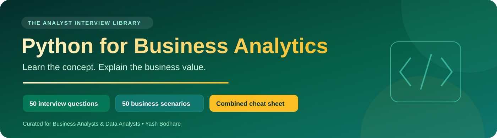

# Python for Business Analytics 🐍

**Learn the concept. Explain why it matters. Validate the business result.**

One interview and revision pack for Business Analysts and Data Analysts, curated by **Yash Bodhare**. Each of the 50 interview questions has a newly written explanation, a small executable example and a question-specific business scenario: the need, why the technique helps, what to validate and the business value.

The chapter sequence follows the topics in the supplied Top 50 PDF. Questions, answers, code and business examples are newly worded. The combined cheat sheet covers the supplied built-ins, common traps, complexity reminders and pandas reference topics. The original PDFs and private delivery links are not included.

> [!TIP]
> Attempt the question before opening its answer. Then explain the business scenario aloud. Use “I would” for hypothetical practice and “I did” only for your actual experience.

## 🧭 Your combined library

| Resource | What it provides |
|---|---|
| [🟩 Cheat sheet](CHEAT_SHEET.md) | Built-ins, data structures, common mistakes and pandas patterns |
| [🟢 Foundations · Q01–Q10](chapters/01-fundamentals.md) | Equality, missing values, mutability, collections and function arguments |
| [🟡 Functions and iteration · Q11–Q20](chapters/02-functions-and-iteration.md) | Decorators, generators, delegation and caching |
| [🟠 Object design · Q21–Q30](chapters/03-object-design.md) | Methods, dataclasses, interfaces, composition and stable keys |
| [🔴 Errors, types and modules · Q31–Q40](chapters/04-errors-types-and-modules.md) | Validation errors, exception handling, typing and imports |
| [🔵 Concurrency · Q41–Q50](chapters/05-concurrency.md) | GIL, async tasks, deadlines, locks, processes and executors |
| [🧪 Runnable practice](practice/README.md) | All 50 interview examples plus a small business-analysis lab |
| [🛡️ Technical review notes](EDITORIAL_NOTES.md) | Important corrections, version boundaries and official references |
| [📚 Coverage and attribution](SOURCES.md) | Exactly which supplied files this edition covers |
| [🚀 GitHub setup](SETUP.md) | Upload instructions and portfolio linking |

## 💼 Answer as an analyst

> “The business needs **[outcome]**. I would use **[technique]** because **[reason]**. I would validate **[edge cases and reconciliation]** before using the result to support **[decision]**.”

The scenarios cover sales imports, revenue reporting, supplier data, CRM enrichment, collections, data quality, auditability, reusable reporting components and reporting deadlines. For engineering-heavy topics, the BA translates business rules into requirements and acceptance criteria and works with the implementation team.

## 🗓️ Five-session study route

1. **Foundations:** study Q01–Q10; explain missing vs zero and original vs working data.
2. **Repeatable work:** study Q11–Q20; explain reusable calculations and reliable iteration.
3. **Design:** study Q21–Q30; connect contracts and data objects to maintainable reporting.
4. **Reliability:** study Q31–Q40; make invalid inputs and failure causes visible.
5. **Performance:** study Q41–Q50; select concurrency from evidence rather than promises.

Review the pandas cheat-sheet section alongside the [business practice lab](practice/README.md), where revenue and joins can be reconciled to explicit expected results.

## ✅ Validation scope

All 50 executable interview examples passed on Python **3.12.14**. The business-analysis lab passed with pandas **2.2.3**. Version-sensitive advice was checked against official Python and pandas documentation. Tests demonstrate the stated examples; they are not production load tests, a static type-checker run or a benchmark of free-threaded Python.

This edition covers the **50 supplied questions**, not the additional libraries listed in the delivery receipt. Some topics intentionally recur from a different angle.

GitHub controls the body font and most text colours. The emerald, teal and gold banner, badges, icons, tables, callouts and expandable answers supply the supported visual styling.
